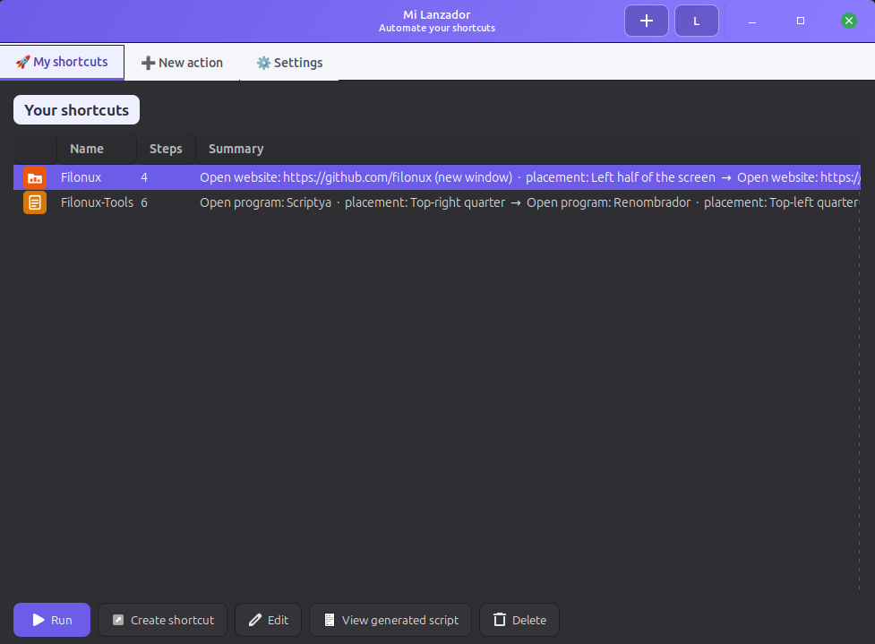
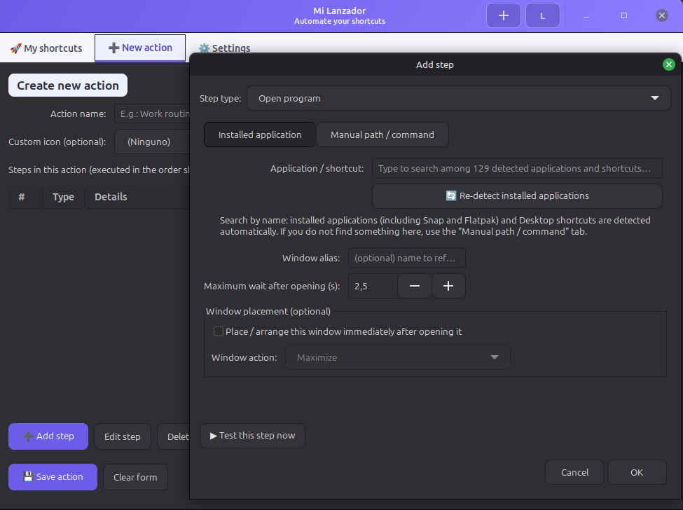
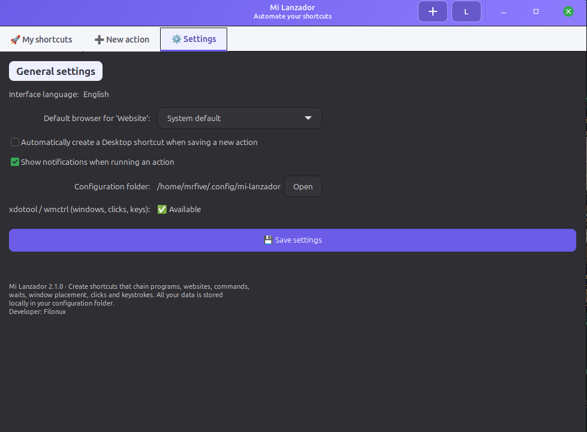

[Leer en español](README.es.md)

<a href="assets/icon.svg"></a>

# Mi Lanzador

Automated shortcut creator for Linux Mint 22.3 (Cinnamon, X11 session).

[](https://www.gnu.org/software/bash/) [](https://linuxmint.com/) [](LICENSE.txt)

Mi Lanzador is a graphical interface for building “actions”: sequences of steps that open programs, documents, websites or commands, place windows, simulate clicks and press keys, chained and executed in order — like an AutoHotkey macro, but using xdotool/wmctrl underneath. Any action can be turned into a one-click shortcut (Desktop and/or applications menu) that executes every step without opening the app window.

In practice, any routine you currently do by hand — opening your work apps and putting them where they belong, getting everything ready to record, filling in the same form every time — can be saved as a single icon that repeats it exactly the same way, every time.

Everything — interface and logic — lives in a single `.sh` file; your data (actions, settings, icons) is stored separately in your configuration folder (see “Where it stores things” below).

## What's new in version 2.1.0

- **Spanish and English interface**, chosen from the system language and switchable in one click (the `L` button). It used to be Spanish-only. See “Language”.
- **Your data is not lost.** Everything the app saves (actions, settings, language, shortcuts, icons) is written atomically: a failure halfway through a save never leaves half-written files. If `acciones.json` or `ajustes.json` is damaged, it is set aside as `<name>.corrupt-<date>` (never overwritten) and the app opens with empty data, telling you so.
- **Copes with hand-edited files.** It accepts the BOM that Windows editors add, ignores fields of the wrong type and repairs empty, duplicated or unusable-as-a-filename ids, instead of failing at startup.
- **More reliable runs.** Launching an action while another is still running no longer erases its log or warnings. A step aimed by alias at a window that has since closed is skipped with a warning, instead of acting on a different one. A click as the first step waits until Mi Lanzador has minimized, so it lands on the window underneath, and it no longer stalls for about 15 seconds when the pointer is already on the click point. And user text containing line breaks cannot inject commands or fake warnings in the generated script.
- **More stable shortcuts and window.** Renaming an action replaces its shortcut (no duplicate) and, if the new one cannot be written, keeps the old one. Installing xdotool/wmctrl no longer freezes the window while apt works, and closing a half-filled form asks for confirmation.
- **Over 450 automated tests** against real GTK3 on Xvfb, plus ShellCheck and pyflakes on every change (see “Tests”).

## Preview

[Demo video](assets/demo.mp4)

https://github.com/user-attachments/assets/8e310451-187f-46ca-92ac-e612d38a0f05





## What each step type does

- **Open program** — a catalogue of what you have installed (system, Snap, Flatpak, desktop shortcuts) or a manual path/command, with arguments when needed.
- **Open document or file** — choose it with the usual file browser; it opens with the system default application (just like a double-click from the file manager) or, if you prefer, by forcing a specific installed application.
- **Open website** — in a tab, in a real new window or “as an app” (without an address bar; Chrome/Chromium/Brave only), with the option to use the system default browser, automatically detected among Firefox, Chrome, Chromium and Brave.
- **Run a command** and **wait** a few seconds. The command opens in a real terminal and stays there, showing its output, until you press Enter.
- **Place window** — maximize, restore normal size, half screen (left, right, top or bottom), screen quarters, centered (80% of the screen), custom size/position as screen percentages, minimize, close. It is integrated into the step that opens the program/document/web/command, and there is also a standalone one for repositioning a window that was already open. With multiple monitors, the percentage is calculated against the monitor where the window is located, not the entire virtual desktop.
- **Click** at absolute X,Y screen coordinates — manually or with a 3-second countdown that lets you place the cursor while the app gets out of the way. Choose the mouse button (left, middle or right) and whether it is a double click. It can activate a specific window first. Two click steps in a row on the same point are sent a fraction of a second apart, which applications may read as a double click: add a wait step between them to keep them separate.
- **Send a key or key combination**, and **type text** — the combination can be captured by pressing it, or entered manually (e.g. `Alt+F10`); both steps can target the last window opened by the action, a previous step by its alias, or a window found by title search.

## Examples of actions you can build

The steps can be chained freely within the same action, so the real limit is your imagination. A few examples to show the scope:

- **Start of the workday** — open your mail, work chat and calendar, each placed in a quarter of the screen, ready at a glance as soon as you sit down.
- **Development environment** — the editor on one side, a terminal with the server running on the other (Run command step), and the browser pointing to `localhost`, each in its place.
- **Presentation mode** — the slides in full screen and, beforehand, a couple of steps that minimize email and chat so that no notification pops up in the middle of the talk.
- **Repetitive form** — open the page, click the first field, type the text, move to the next with Tab... the same weekly task reduced to one click.
- **End of the workday** — the reverse of startup: minimize or close everything work-related with one icon when you finish the day.
- **Controlling a window that is already open** — it finds the window by title (a music player, for example), activates it and sends it a key (pause, say), without you having to go and look for it.

And because each saved action has its own icon, the next time you do not even need to open Mi Lanzador: a double click on the Desktop (or the keyboard shortcut you assign to it — see “Run an action without opening the window” below) starts everything.

## Other features

- **Per-action icon** — you can use your own image (PNG, SVG, JPG, ICO or XPM) for each action; if you do not choose one, an automatic icon is selected based on the first step.
- **Test this step now** — while creating or editing a step, you can run just that step to check what it does, without saving the action or touching the other steps.
- **View generated script** — for each saved action you can view the actual bash script that is executed, step by step.
- **Desktop notifications** — it reports when an action starts, and again if something goes wrong; this can be disabled in Settings.
- **Settings** — default browser for “Website”, automatically create a Desktop shortcut when saving a new action (otherwise it asks you every time), notifications, direct access to the configuration folder, and a button to (re)install xdotool/wmctrl whenever you want.
- **Bilingual interface** — Spanish/English, detected automatically from the system locale (English if it is not Spanish). See “Language” below.

When creating a shortcut you choose Desktop, applications menu, or both. If Cinnamon asks you to “trust” or “allow execution” when you double-click it for the first time, that is normal — accept it once and it will not ask again.

## Language

Mi Lanzador uses the system language only as the initial default. A saved choice in `~/.config/mi-lanzador/idioma` takes priority, so changing the desktop locale later does not unexpectedly change the interface. The `L` button (or the `L` key when the focus is not in a text field or a list) switches between `es` and `en` and saves the choice.

For diagnostics or automated tests, `mi-lanzador.sh --print-language` prints the language that will be used. The `MI_LANZADOR_LANG=es` or `MI_LANZADOR_LANG=en` environment variable can be used to force a language for a single launch without changing the saved preference.

## Requirements

- Linux Mint 22.3, Cinnamon, **X11** session — on Wayland the app opens normally, but window placement, clicks and automated keyboard input are unavailable (details in “About Wayland” below).
- Python 3 (already included with the system).
- GTK3 for Python: `python3-gi gir1.2-gtk-3.0 python3-gi-cairo gir1.2-notify-0.7`
- `xdotool` and `wmctrl`, only if you are going to place windows, click, send keys or type text (including integrated placement inside open program/document/web/command).

The script detects whether GTK3 and xdotool/wmctrl are missing and offers to install them with `pkexec`, asking for explicit confirmation before touching anything. If you say no, or `pkexec` is unavailable, it gives you the exact command so you can do it yourself. For xdotool/wmctrl you can also retry whenever you like from Settings → “Install now”; GTK3 has no such button — without it the interface cannot start, so there is no Settings screen to enter — simply run the script again after installing it manually. Python 3 is the only requirement the script does not offer to install for you: if it were missing (which should not happen on a normal Mint installation), it shows the command directly.

## Compatibility with other distributions

Mi Lanzador is developed and tested on Linux Mint 22.3 (Cinnamon, X11), and that is the only fully supported combination. That said, the script does not impose a distribution lock: it never checks which distribution you are running, so on any Linux/X11 session with GTK3 it should behave the same. Several parts are intentionally generic — it detects installed terminals (`gnome-terminal`, `mate-terminal`, `xfce4-terminal`, `tilix`, `terminator`, `konsole`, `xterm`...), browsers (Firefox/Chrome/Chromium/Brave, with package-name variants), and places windows using standard EWMH properties implemented by most X11 window managers (XFCE Xfwm4, MATE Marco, KWin on X11, Mutter on Xorg...), although it has only been tuned and tested thoroughly against Muffin, the Cinnamon window manager.

The only part tied to Mint/Ubuntu/Debian is automatic dependency installation, which uses `apt`. On a distribution with a different package manager that automatic installation will not work, but if you install the equivalent packages yourself before launching it, the rest of the application should start normally:

| Distro | Package manager | Approximate packages |
|---|---|---|
| Fedora / RHEL | `dnf` | `python3-gobject gtk3 python3-cairo libnotify xdotool wmctrl` |
| openSUSE | `zypper` | `python3-gobject typelib-1_0-Gtk-3_0 typelib-1_0-Notify-0_7 xdotool wmctrl` |
| Arch / Manjaro | `pacman` | `python-gobject gtk3 python-cairo libnotify xdotool wmctrl` |

(Package names are indicative — check your distribution's package search; they can vary between versions.)

As with Wayland (see below), window placement, clicks and keyboard input do not work there on any desktop, so that limitation is independent of the distribution.

## Installation

Download [`script/mi-lanzador.sh`](script/mi-lanzador.sh) (with GitHub's download button) and, from the folder where you saved it, run:

```bash
chmod +x mi-lanzador.sh
./mi-lanzador.sh
```

That is all. The first time:

1. It copies itself to `~/.local/share/mi-lanzador/mi-lanzador.sh` — that becomes the “installed” copy; the `.sh` you downloaded is no longer needed.
2. It installs its icon, creates its launcher in the applications menu and leaves a copy on your Desktop.
3. It checks dependencies and asks before installing anything that is missing.

After that, open it from the menu or Desktop icon like any other app.

## Install and launch Mi Lanzador with Scriptya (optional)

[Scriptya](https://github.com/filonux/Scriptya) is a script launcher: it organizes your scripts in a searchable menu and can turn any of them into a desktop app with its own icon, without writing a `.desktop` file by hand. You can add optional metadata from Scriptya to keep it organized with a name and description, change its icon, etc.

## Where it stores things

| What | Where |
|---|---|
| Actions | `~/.config/mi-lanzador/acciones.json` |
| Settings | `~/.config/mi-lanzador/ajustes.json` |
| Custom icons | `~/.config/mi-lanzador/iconos/` |
| Language preference | `~/.config/mi-lanzador/idioma` |
| Last-run log | `~/.config/mi-lanzador/ultima_ejecucion.log` |
| Error log | `~/.config/mi-lanzador/error.log` |
| Installed script | `~/.local/share/mi-lanzador/mi-lanzador.sh` |
| Launcher icon | `~/.local/share/icons/hicolor/scalable/apps/mi-lanzador.svg` |

Any unexpected error is recorded in the error log and also shown in a notification: it does not fail silently, because the app is normally opened with a double click, with no terminal where you can see anything. The last-run log, by contrast, is the output of the last action you launched (warnings included) — useful to see why a particular step did not do what you expected.

If `acciones.json` or `ajustes.json` cannot be read, it is kept in the same folder as `<name>.corrupt-<date>`, the app opens with empty data and tells you so. The error log is rotated to `error.log.1` once it exceeds 256 KB.

## About Wayland

If your Cinnamon session is native Wayland, opening programs/websites/commands works normally, but window placement, clicking, sending keys and typing text **will not work**, even if xdotool and wmctrl are installed — this is a limitation of those tools, not of the script. It detects this automatically and warns once a day. To have all features, choose the “Cinnamon” (X11) session on the login screen, not the one labelled “Cinnamon (Wayland)”.

## Run an action without opening the window

```bash
mi-lanzador.sh --ejecutar <action_id>
```

It runs that action from start to finish without showing any window. This is what the `.desktop` shortcuts generated by the app use internally, and it works just as well for assigning a keyboard shortcut to it from Cinnamon. The `id` is the action's `id` field in `acciones.json`; it also appears at the end of the `Exec=` line of its shortcut.

## Under the hood

A single `.sh`: the bash part handles self-installation, checks/installs dependencies and warns about Wayland; at the end it uses `exec python3` on a heredoc containing the whole PyGObject (GTK3) interface. No build step, no custom packages to install — the file is the program.

## Tests

`bash tests/test_project.sh` checks the script's syntax and runs over 450 tests that start the real GTK3 interface on a virtual Xvfb with Openbox; the dependencies it needs are listed in [CONTRIBUTING.md](.github/CONTRIBUTING.md). GitHub Actions runs the same command on every pull request and on every push to the default branch, together with ShellCheck and pyflakes on the embedded Python.

## License

See the [LICENSE.txt](LICENSE.txt) file in this repository.

---

Made by **[Filonux](https://github.com/filonux)**.
